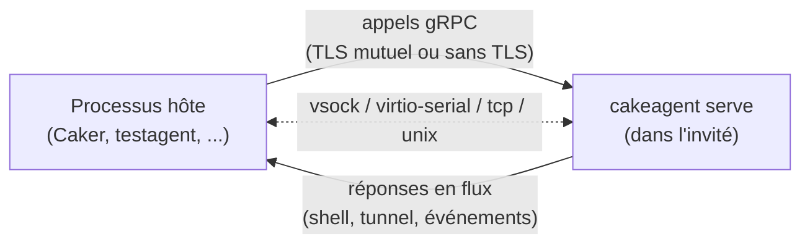
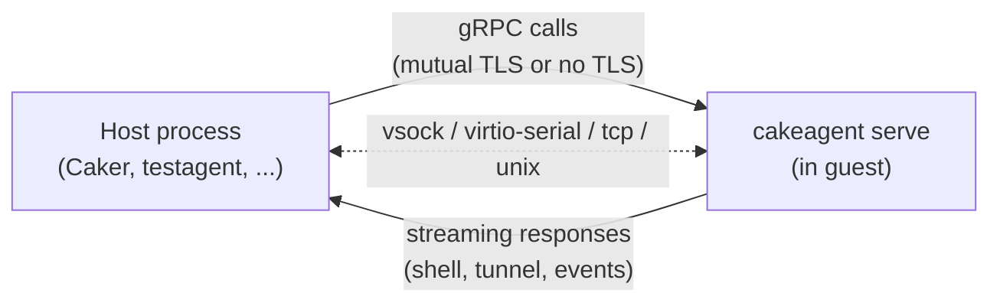

<!-- markdownlint-disable MD033 MD024 -->

# Architecture

L'agent lie un **serveur gRPC** dans l'invité et l'hôte s'y connecte par l'un des transports ci-dessous. Chaque RPC est défini une seule fois, dans `proto/agent.proto`, et implémenté deux fois (Go et Swift) : l'hôte obtient le même comportement quel que soit le système invité.

## Deux implémentations, un contrat

| Plateforme | Langage | Point d'entrée | Rôle |
|---|---|---|---|
| Invités Linux et Windows | Go | `linux/main.go` | Agent principal, `linux/{amd64,arm64}` et `windows/{amd64,arm64}` |
| Invités macOS | Swift | `darwin/Sources/CakeAgent` | Agent macOS signé et notarisé, binaire universel ou `.pkg` |
| Bibliothèque cliente | Swift | `darwin/Sources/CakeAgentLib` | Client gRPC partagé, utilisé par `testagent` et par Caker |
| Client de référence | Swift | `darwin/Sources/TestAgent` | CLI qui exerce chaque RPC sur l'un ou l'autre agent |

Le module Go se compile aussi pour Darwin ; ces binaires sont publiés avec les versions, mais l'agent macOS livré dans le `.pkg` est le build Swift.

## Transports et adresses

`--listen` (serveur) est une URL dont le schéma choisit le transport :

| Schéma | Exemple | Notes |
|---|---|---|
| `vsock` | `vsock://any:5000`, `vsock://host:5000`, `vsock://<cid>:5000` | Par défaut (hors Windows). `any`, `host` et `hypervisor` sont des identifiants de contexte connus, sinon un CID numérique |
| `virtio` | `virtio://<nom-du-port>` | Écoute `/dev/virtio-ports/<nom-du-port>` (virtio-serial), quand vsock n'est pas disponible |
| `tcp` | `tcp://127.0.0.1:5010` | TCP simple, surtout pour le développement local (par défaut sous Windows) |
| `unix` | `unix:///chemin/agent.sock` | Socket de domaine unix |

Sous Windows, le build Go sait écouter en `tcp://` et `vsock://` (pas `virtio://` ni `unix://`) : voir [Invités Windows](windows-guests).

## Sécurité

Avec `--ca-cert`, `--tls-cert` et `--tls-key`, le canal est protégé par TLS mutuel : l'agent n'accepte que les clients dont le certificat est signé par la CA. Sans elles, aucune sécurité de transport : réservé au développement local. L'agent tourne en root dans l'invité et peut exécuter des commandes, monter des systèmes de fichiers et éteindre la machine : traitez sa clé privée et la CA comme des secrets.

## Disposition du dépôt

- `Package.swift` : manifeste SwiftPM, produits `cakeagent`, `testagent`, `CakeAgentLib`
- `darwin/Sources/CakeAgent`, `CakeAgentLib`, `TestAgent` et `darwin/Tests` : agent, bibliothèque, client de référence et tests Swift
- `linux/main.go` : CLI Go et serveur de l'agent
- `linux/pkg` : implémentation du service gRPC et de ses parties : `mount`, `tunnel`, `resize`, `serialport`, `event`, `seamless` (superviseur du compositeur Linux), `display` (taille d'affichage Windows), `utils`
- `linux/service` : installation du service (systemd ou OpenRC sous Linux, launchd sous Darwin, service Windows)
- `linux/console` : gestion du PTY et de la console pour `Execute`
- `proto/agent.proto` : le contrat ; `proto/generate.sh` régénère les stubs
- `scripts/` : scripts de lancement local et build du compositeur seamless
- `tests/` : clients Go et Swift autonomes qui valident les RPC de bout en bout
- `.ci/` : signature, empaquetage `.pkg` et notarisation macOS
- `_artifacts/` (non versionné) : sortie de build

# Architecture

The agent binds a **gRPC server** inside the guest and the host connects to it over one of the transports below. Every RPC is defined once, in `proto/agent.proto`, and implemented twice (Go and Swift): the host gets the same behavior whatever the guest OS.

## Two implementations, one contract

| Platform | Language | Entry point | Role |
|---|---|---|---|
| Linux and Windows guests | Go | `linux/main.go` | Primary agent, `linux/{amd64,arm64}` and `windows/{amd64,arm64}` |
| macOS guests | Swift | `darwin/Sources/CakeAgent` | Code-signed, notarized macOS agent, universal binary or `.pkg` |
| Client library | Swift | `darwin/Sources/CakeAgentLib` | Shared gRPC client, used by `testagent` and by Caker |
| Reference client | Swift | `darwin/Sources/TestAgent` | CLI that exercises every RPC against either agent |

The Go module also builds for Darwin; those binaries are published with the releases, but the macOS agent shipped in the `.pkg` is the Swift build.

## Transports and addresses

`--listen` (server side) is a URL whose scheme selects the transport:

| Scheme | Example | Notes |
|---|---|---|
| `vsock` | `vsock://any:5000`, `vsock://host:5000`, `vsock://<cid>:5000` | Default (except on Windows). `any`, `host` and `hypervisor` are well-known context IDs, otherwise a numeric CID |
| `virtio` | `virtio://<port-name>` | Listens on `/dev/virtio-ports/<port-name>` (virtio-serial), when vsock is not available |
| `tcp` | `tcp://127.0.0.1:5010` | Plain TCP, mainly for local development (default on Windows) |
| `unix` | `unix:///path/to/agent.sock` | Unix domain socket |

On Windows the Go build listens on `tcp://` and `vsock://` (not `virtio://` or `unix://`): see [Windows guests](windows-guests).

## Security

With `--ca-cert`, `--tls-cert` and `--tls-key` the channel is protected by mutual TLS: the agent only accepts clients whose certificate is signed by the CA. Without them there is no transport security: for local development only. The agent runs as root in the guest and can run commands, mount filesystems and power the machine off: treat its private key and the CA as secrets.

## Repository layout

- `Package.swift`: SwiftPM manifest, products `cakeagent`, `testagent`, `CakeAgentLib`
- `darwin/Sources/CakeAgent`, `CakeAgentLib`, `TestAgent` and `darwin/Tests`: the Swift agent, library, reference client and tests
- `linux/main.go`: the Go CLI and agent server
- `linux/pkg`: the gRPC service and its parts: `mount`, `tunnel`, `resize`, `serialport`, `event`, `seamless` (the Linux compositor supervisor), `display` (Windows display size), `utils`
- `linux/service`: service installation (systemd or OpenRC on Linux, launchd on Darwin, a Windows service)
- `linux/console`: PTY and console handling for `Execute`
- `proto/agent.proto`: the contract; `proto/generate.sh` regenerates the stubs
- `scripts/`: local run scripts and the seamless compositor build
- `tests/`: standalone Go and Swift clients that validate the RPCs end to end
- `.ci/`: macOS signing, `.pkg` packaging and notarization
- `_artifacts/` (not committed): build output

